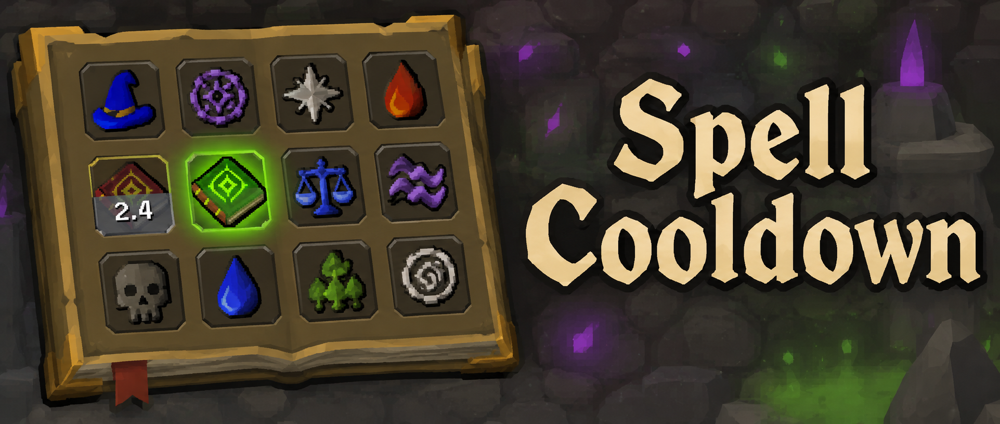

Spell Cooldown is a RuneLite plugin that shows, right on the spellbook icon, when a spell is casting and when you can cast it again.

## Features

### Casting

- **Grey cover with a smooth countdown**

  Cast a skilling spell, such as Degrime or High Level Alchemy, and its icon turns grey. The grey wipes away from top to bottom while the spell casts, with the seconds left counting down in the middle of the icon. The countdown updates every frame, not every game tick.

### Ready

- **Green flash**

  When the cast finishes, the icon flashes green twice. Then it is back to normal and ready to cast again.

The timing comes from each spell's casting speed on the OSRS wiki (Degrime: 8 ticks). A spell with no known timing stays grey until its Magic XP drop instead.

### Bank-close warning

- **Grey icons after closing the bank**

  A spell clicked in the tick right after the bank closes is often silently ignored by the game. For 0.6 seconds after you close the bank, your spell icons are greyed out. Cast once the grey clears.

### Nothing to cast on

- **Grey icons when your inventory has nothing for the spell**

  A spell is greyed out while your inventory has nothing for it to work on: Degrime with no grimy herbs, Bake Pie with no uncooked pies, String Jewellery with no unstrung amulets, an enchant spell with no matching jewellery, and so on. Hunter Kit is greyed out while you already carry a kit or every tool it contains. Alchemy and the farming-patch spells are never greyed out this way.

### Settings

- Cover colour and flash colour
- Show or hide the countdown
- Number of green flashes
- Bank-close warning on or off
- Grey out with nothing to cast on, on or off

## Supported spells

| Spellbook | Spells |
|---|---|
| Standard | Low and High Level Alchemy, Lvl-1 to Lvl-7 Enchant, Superheat Item, Bones to Bananas, Bones to Peaches, Charge Water/Earth/Fire/Air Orb |
| Lunar | Bake Pie, Plank Make, Superglass Make, Humidify, String Jewellery, Tan Leather, Spin Flax, Recharge Dragonstone, Fertile Soil, Hunter Kit, Cure Plant |
| Arceuus | Degrime, Demonic Offering, Sinister Offering, Resurrect Crops, Basic/Adept/Expert/Master Reanimation |

Targeted spells such as alchemy and enchant start their countdown when you click the item or object, not when you select the spell. When an enchant spell sits in the collapsed Jewellery Enchantments submenu, the countdown shows on that button.

## Links

- [Report a bug](https://github.com/Oveduumnakal/Spell-Cooldown-Plugin/issues/new?template=bug_report.yml)
- [Request a feature](https://github.com/Oveduumnakal/Spell-Cooldown-Plugin/issues/new?template=feature_request.yml)
- [Buy me a coffee](https://buymeacoffee.com/oveduumnakal)
